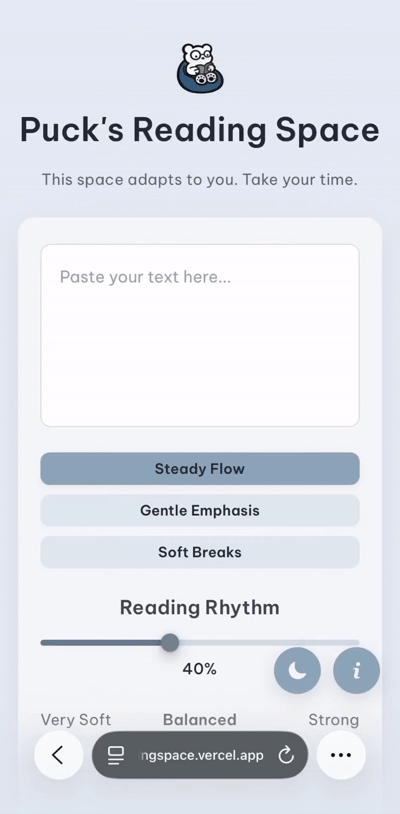

Puck's Reading Space: A safe haven for digital reading

Puck's Reading Space is the flagship product of PuckReads, a student-led initiative exploring ways to make digital reading experience more comfortable and accessible for friends around the world.

Reading doesn't feel the same for everyone. Dense paragraphs, visual navigation, and difficulty maintaining attention can make digital reading challenging. Puck's Reading Space explores a simple question:

_Instead of asking readers to adapt to the text, what if the text could adapt to them?_

Designed around flexibility rather than a one-size-fits-all approach, the platform offers three customizable reading modes, so readers can personalize their digital reading experience at their own pace!

01. Steady Flow:
A focus-supporting mode that helps readers direct their attention through the text

02. Gentle Emphasis:
Subtle typographic emphasis designed to make words easier to navigate visually

03. Soft Breaks:
Breaks text into smaller, more manageable chunks while preserving the natural flow of sentences.

Brainstorming in Dec 2025, building from Jan 2026, public launch in July 2026

Built with HTML/CSS/Javascript

Hosted on Vercel

Link to space: pucksreadingspace.vercel.app

Active User counts: 3K+

Visit us on Instagram at @puckreads

© 2026 Puck's Reading Space. Made with care <3
